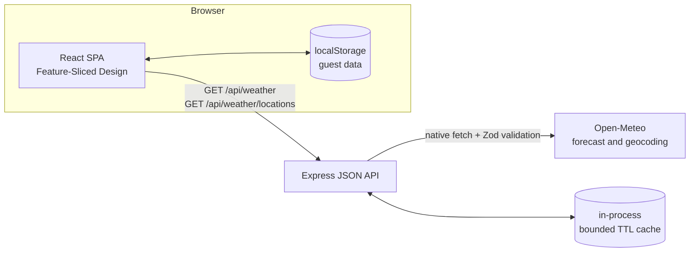

# Walday

Walday is a personal daily planning web application that brings tasks, scheduled commitments, a
chronological agenda, weather context, and rule-based planning suggestions into one daily experience.

The repository contains a React single-page application (`frontend/`) and an independent Express JSON
API (`backend/`). Guest data is currently stored in the browser; the backend provides the weather and
location-search proxy used by the frontend.

## Project Overview

People often manage their day across separate task lists, calendars, weather apps, and reminders.
Walday addresses that fragmentation by showing the day's activities together and by helping users
understand how tasks, commitments, available time, and weather relate to one another.

The product vision is to help people plan their days with greater clarity and confidence while
keeping the user in control. Walday may suggest changes, but it does not silently modify an agenda or
automatically reschedule fixed commitments.

Main capabilities:

- A daily dashboard that combines the agenda, tasks, commitments, weather, and planning suggestions.
- Personal task management with completion, priority, optional due date, and estimated duration.
- Fixed and flexible commitments with conflict detection.
- A chronological daily agenda with available-time information and optional task scheduling.
- Current weather and hourly forecasts through a backend proxy, with unit preferences and
  last-known-good fallback.
- Explainable, rule-based planning suggestions that the user can accept, adjust, or dismiss.
- Guest preferences for language, date/time presentation, weather units, and weather location.
- English and Spanish interfaces, responsive layouts, and a dark visual theme.

## Key Features

### Implemented in the repository

| Area | Capability |
| --- | --- |
| Daily dashboard | Home shows the selected day's agenda, with current-day weather and planning suggestions; the agenda includes scheduled tasks and commitments. |
| Task management | Create, edit, delete, complete, and reopen tasks; set priority, optional due date, and estimated duration. Tasks may remain unscheduled. |
| Daily commitments | Create, edit, and delete fixed or flexible commitments with start and end times. Fixed commitments are protected from automatic rescheduling. |
| Daily agenda | Chronological timeline of scheduled tasks and commitments, including overlaps, available periods, and task scheduling or unscheduling from the day view. |
| Weather | Current conditions and hourly forecast for a saved location, displayed in metric or imperial units. Weather is always optional context. |
| Weather resilience | Backend timeout, bounded retry, TTL caching, negative caching, and client-side last-known-good weather marked as stale when necessary. |
| Planning suggestions | Rule-based conflict, free-slot, and flexible-commitment suggestions with textual reasons, accept, adjust, and dismiss actions, plus per-device dismissal memory. |
| Preferences | Interface language (`en`/`es`), date/time presentation, weather units, and optional weather location. |
| Guest persistence | Tasks, commitments, preferences, weather snapshot, and suggestion dismissals are stored in versioned `localStorage` records. |
| UI and accessibility | Responsive dark theme, semantic design tokens, keyboard support, live regions, focus management, and automated accessibility checks. |

### Planned by the product overview but not implemented here

These capabilities are part of the product's stated MVP scope but have no implementation in this
repository yet:

- User accounts with email/password authentication.
- Google sign-in.
- Cloud synchronization across devices.
- Guest-to-account data migration.
- Server-side persistence of user data.
- PWA installation and offline capabilities.

Weather location search depends on the backend proxy. Without a configured `VITE_API_BASE_URL`, the
frontend reports weather and location search as unavailable while tasks, commitments, preferences,
and the agenda continue to work.

## Technology Stack

### Frontend

| Responsibility | Technology |
| --- | --- |
| UI framework | React 19 |
| Language | TypeScript 5 (strict configuration) |
| Build and dev server | Vite 8 |
| Styling | Tailwind CSS 4 via `@tailwindcss/vite`; `@theme` in `src/index.css` is the token source |
| Routing | React Router 7 |
| Server state | TanStack Query 5 |
| Runtime validation | Zod 4 |
| Internationalization | i18next 26 and react-i18next 17 |
| Icons and font | `lucide-react`; Inter Variable through `@fontsource-variable/inter` |
| Unit and component tests | Vitest 5, React Testing Library, jest-dom, axe-core |

### Backend

| Responsibility | Technology |
| --- | --- |
| Runtime | Node.js 24 LTS |
| HTTP framework | Express 5 |
| Language | TypeScript 5 (strict configuration) |
| Runtime validation | Zod 4 |
| Weather provider | Open-Meteo through native `fetch`; no provider SDK |
| Tests | Vitest 5 with route-level integration tests |

The backend is a stateless weather and geocoding proxy. It has no authentication layer, no
database, and no repository layer yet.

### Database

No database is integrated in the current repository. There is no Prisma schema, migration directory,
PostgreSQL dependency, or database configuration. The constitution describes PostgreSQL and Prisma
as the intended persistence stack, but that target is not implemented here.

### Testing

- Vitest for frontend and backend tests.
- React Testing Library and jest-dom for frontend behavior tests.
- axe-core for automated accessibility checks in frontend tests.
- V8 coverage reporting through `@vitest/coverage-v8`.

### Development tools and infrastructure

- ESLint 10 and Prettier 3 for linting and formatting checks.
- Husky 9 and lint-staged 16 for Git hooks.
- GitHub Actions CI in `.github/workflows/ci.yml`.
- Node version pinned in `.nvmrc` (`24`).
- Separate lockfiles at the repository root, `frontend/`, and `backend/`.

No Docker, container, or deployment configuration is present in the repository.

## Architecture Overview

Walday uses a frontend/backend split:

- The **frontend** is a client-side React SPA. It owns the user interface, guest data persistence,
  local planning rules, and the presentation of weather and suggestions.
- The **backend** is an independent JSON API. It validates requests, applies timeouts, retries,
  caching, and rate limiting, calls Open-Meteo, and maps provider data to an internal weather model.
- The two applications communicate over HTTP with JSON. The frontend never calls Open-Meteo
  directly; it calls the backend using `VITE_API_BASE_URL`.
- There is no database connection, session store, or authenticated API in the current
  implementation. Guest domain data lives in `localStorage`.

### Frontend architecture

The frontend follows Feature-Sliced Design with a one-way dependency direction:

```text
app → pages → widgets → features → entities → shared
```

- `app` contains providers, bootstrap, routing, query configuration, and route-level error handling.
- `pages` compose screens such as Home, Tasks, Settings, and Commitments.
- `widgets` compose larger interface regions such as the application shell, dashboard, weather card,
  agenda, and suggestion surface.
- `features` implement user interactions and use cases: tasks, commitments, agenda, weather,
  preferences, and suggestions.
- `entities` hold domain models, validation, storage, and rules for tasks, commitments, preferences,
  and weather.
- `shared` contains UI primitives, internationalization, configuration, formatting utilities, and
  test helpers.

Each slice exposes a public `index.ts`; cross-slice imports of internal files are restricted by
ESLint. The `@/` alias points to `frontend/src`.

### Backend architecture

The backend follows a layered request flow:

```text
routes → controllers → services → providers / lib
```

- `routes` define paths and attach validation and rate-limiting middleware.
- `controllers` map validated input to a service result and an HTTP response.
- `services` hold weather and location business rules, cache behavior, and error mapping.
- `providers` build Open-Meteo requests, apply timeouts and retries, and validate provider payloads.
- `middleware` handles CORS, request logging, not-found responses, centralized errors, and rate
  limiting.
- `lib` contains the bounded TTL cache, retry helpers, time utilities, and other infrastructure.

Every endpoint validates its query with a strict Zod schema. Errors use a single envelope:

```json
{ "error": { "code": "WEATHER_UNAVAILABLE", "message": "..." } }
```

The public API currently exposes two unauthenticated `GET` endpoints:

| Endpoint | Purpose |
| --- | --- |
| `GET /api/weather?latitude=<number>&longitude=<number>` | Current conditions and hourly forecast in canonical metric units. |
| `GET /api/weather/locations?query=<text>&language=<en\|es>&limit=<1-10>` | Location search candidates. |

### System diagram



Weather failure is isolated from the rest of the application. The frontend can retain a
last-known-good snapshot, mark it as stale, and continue to support tasks, commitments, and the
agenda.

## Repository Structure

```text
walday/
├── frontend/                    React SPA
│   ├── src/
│   │   ├── app/                 bootstrap, providers, router, query client
│   │   ├── pages/               Home, Tasks, Settings, Commitments, Foundation, Not Found
│   │   ├── widgets/             shell, dashboard, agenda, weather, suggestions
│   │   ├── features/            tasks, commitments, agenda, weather, preferences, suggestions
│   │   ├── entities/            task, commitment, preference, and weather domain logic
│   │   ├── shared/              UI primitives, i18n, config, formatting, guest storage helpers
│   │   └── test/                frontend test setup and accessibility helpers
│   ├── tests/                   Vitest behavior and integration tests
│   ├── public/                  static assets
│   └── vite.config.ts           Vite, Vitest, alias, and coverage configuration
├── backend/                     Express weather and location API
│   ├── src/
│   │   ├── routes/              endpoint definitions and middleware wiring
│   │   ├── controllers/         HTTP request/response mapping
│   │   ├── services/            weather and location business rules
│   │   ├── providers/           Open-Meteo clients and payload schemas
│   │   ├── middleware/          CORS, errors, logging, rate limiting, not found
│   │   ├── domain/              weather model, conditions, and stable error codes
│   │   ├── lib/                 cache, retry, and time utilities
│   │   ├── config/              validated environment configuration
│   │   ├── app.ts               application assembly
│   │   └── server.ts            process entry point
│   └── tests/                   route, provider, cache, and error tests
├── docs/
│   ├── product-overview.md      product vision, scope, rules, and UX requirements
│   └── adr/                     architecture decision records
├── specs/                       Spec Kit feature artifacts (001–009)
├── .specify/                    project constitution and specification templates
├── .github/workflows/ci.yml     continuous integration
├── .husky/                      local Git hooks
├── AGENTS.md                    repository working instructions
├── .nvmrc                       pinned Node.js version
└── package.json                 root delegation scripts and development tooling
```

The root package is not an npm workspace. It provides convenience scripts that call the independent
`frontend/` and `backend/` packages with `npm --prefix`.

## Prerequisites

- **Node.js 24** (`>=24 <25`, as required by the package manifests and `.nvmrc`).
- **npm 11 or newer**.
- **Git**.
- Network access to Open-Meteo for live weather and location search.
- No database, Docker, or external account is required for local development.

## Getting Started

### 1. Clone the repository

```bash
git clone <repository-url> walday
cd walday
```

### 2. Install dependencies

```bash
nvm use            # or install Node.js 24 LTS manually
npm ci             # root tooling: Husky and lint-staged
npm ci --prefix frontend
npm ci --prefix backend
```

Installing at the root triggers the `prepare` script, which installs the Husky Git hooks.

### 3. Configure environment variables

No secrets belong in the repository. Both applications validate configuration at startup.

**Frontend**

No environment variable is required for the basic SPA. To connect the frontend to the local backend,
create `frontend/.env.local`:

```dotenv
VITE_API_BASE_URL=http://localhost:8787
```

| Variable | Required | Purpose |
| --- | --- | --- |
| `VITE_API_BASE_URL` | No | Base URL of the Walday backend. When omitted, weather and location search report unavailable. Must be a valid URL. |

Only public, non-sensitive values may use the `VITE_*` prefix. See `frontend/.env.example`.

**Backend**

The backend ships with working defaults. To override them, copy the example file:

```bash
cp backend/.env.example backend/.env
```

| Variable | Default | Purpose |
| --- | --- | --- |
| `PORT` | `8787` | HTTP port for the API. |
| `CORS_ALLOWED_ORIGINS` | `http://localhost:5173` | Comma-separated list of allowed frontend origins. |
| `TRUST_PROXY` | `false` | Trust proxy headers when deployed behind a proxy. |
| `OPEN_METEO_FORECAST_BASE_URL` | `https://api.open-meteo.com/v1/forecast` | Forecast provider endpoint. |
| `OPEN_METEO_GEOCODING_BASE_URL` | `https://geocoding-api.open-meteo.com/v1/search` | Geocoding provider endpoint. |
| `REQUEST_TIMEOUT_MS` | `4000` | Outbound provider request timeout. |
| `WEATHER_CACHE_TTL_MS` | `600000` | Weather cache lifetime (10 minutes). |
| `LOCATION_CACHE_TTL_MS` | `600000` | Location cache lifetime (10 minutes). |
| `NEGATIVE_CACHE_TTL_MS` | `30000` | Failure cache lifetime (30 seconds). |
| `RATE_LIMIT_WINDOW_MS` | `60000` | Rate-limit window (1 minute). |
| `LOCATION_RATE_LIMIT` | `30` | Location requests allowed per window per IP. |
| `WEATHER_RATE_LIMIT` | `60` | Weather requests allowed per window per IP. |

See `backend/.env.example` for the authoritative documented list.

### 4. Set up the database

No database setup is required. The repository has no schema, database service, or migration step.
Guest data persists in the browser's `localStorage`.

### 5. Start the applications

Start both applications from the repository root:

```bash
npm run dev
```

Alternatively, run them in separate terminals:

```bash
npm run dev:backend     # http://localhost:8787
npm run dev:frontend    # http://localhost:5173
```

The frontend dev server uses Vite's default port unless it is already occupied. The backend port is
controlled by `PORT`.

### 6. Access the application

| Service | URL |
| --- | --- |
| Web application | `http://localhost:5173` |
| Backend API | `http://localhost:8787` |

Smoke-test the API:

```bash
curl "http://localhost:8787/api/weather/locations?query=Madrid&language=en&limit=5"
curl "http://localhost:8787/api/weather?latitude=40.4165&longitude=-3.7026"
```

### Production build

Set `VITE_API_BASE_URL` before building the frontend, because Vite embeds environment values at
build time.

```bash
npm run build
npm --prefix backend start
npm --prefix frontend run preview
```

## Development Commands

### Root commands

Run from the repository root:

| Command | Purpose |
| --- | --- |
| `npm run dev` | Start the backend and frontend development servers together. |
| `npm run dev:frontend` | Start only the Vite development server. |
| `npm run dev:backend` | Start only the backend with Node watch mode. |
| `npm run lint` | Run ESLint for frontend and backend. |
| `npm run format:check` | Check formatting with Prettier for both applications. |
| `npm run typecheck` | Type-check both applications. |
| `npm run test` | Run frontend and backend Vitest suites. |
| `npm run test:coverage` | Run both suites with coverage thresholds. |
| `npm run build` | Build the frontend and backend. |

Each root command also has `:frontend` and `:backend` variants where applicable, for example
`npm run lint:frontend`, `npm run typecheck:backend`, or `npm run test:frontend`.

The repository exposes formatting as a **check** only (`format:check`); there is no root `format`
write script.

### Frontend commands

Run from the repository root with the root scripts, or from `frontend/` directly:

| Command | Purpose |
| --- | --- |
| `npm run dev` | Start the Vite development server. |
| `npm run build` | Type-check and create a production Vite build. |
| `npm run preview` | Serve the production build locally. |
| `npm run lint` | Run ESLint with import-boundary and React rules. |
| `npm run format:check` | Check formatting with Prettier. |
| `npm run typecheck` | Run `tsc -b` across the frontend project references. |
| `npm run test` | Run Vitest in watch-free mode. |
| `npm run test:coverage` | Run Vitest with V8 coverage thresholds. |

### Backend commands

Run from the repository root with the root scripts, or from `backend/` directly:

| Command | Purpose |
| --- | --- |
| `npm run dev` | Start the API with `node --watch`. |
| `npm run build` | Compile TypeScript to `backend/dist`. |
| `npm run start` | Run the compiled API from `backend/dist`. |
| `npm run lint` | Run ESLint. |
| `npm run format:check` | Check formatting with Prettier. |
| `npm run typecheck` | Type-check the backend. |
| `npm run test` | Run the backend Vitest suite. |
| `npm run test:coverage` | Run tests with V8 coverage thresholds. |

### Git hooks and CI

- Pre-commit: lint-staged with ESLint and Prettier on staged files, plus formatting checks.
- Pre-push: type checking, tests with coverage, and build validation.
- CI runs clean installs followed by `lint`, `format:check`, `typecheck`, `test`, `test:coverage`,
  and `build` on Node 24.

If the hooks do not run, reinstall root dependencies with `npm ci` and verify the files in `.husky/`.
CI is authoritative; hooks are a local convenience.

## Testing and Quality Standards

The project constitution (`.specify/memory/constitution.md`) is the authoritative engineering
standard. The main expectations are:

- **Strict TypeScript everywhere.** `strict`, `noUncheckedIndexedAccess`,
  `noImplicitOverride`, `noFallthroughCasesInSwitch`, `noUnusedLocals`,
  `noUnusedParameters`, and `verbatimModuleSyntax` are enabled. `any` is prohibited.
- **Runtime validation at boundaries.** Zod validates environment variables, browser storage,
  HTTP requests and responses, and third-party provider payloads.
- **Architecture boundaries.** The frontend follows Feature-Sliced Design; the backend follows
  routes → controllers → services with centralized error handling. Cross-slice internals and
  provider DTOs must not leak across boundaries.
- **Test observable behavior.** Tests use the Arrange-Act-Assert pattern, avoid real network calls,
  control time deterministically, and cover loading, empty, error, success, and relevant boundary
  states.
- **Coverage thresholds are enforced.** Frontend global coverage requires 80% statements, branches,
  functions, and lines, with stricter thresholds for `entities` and `features`. Backend global
  coverage requires 80% statements, functions, and lines and 75% branches. The constitution also
  targets approximately 90% for critical business logic.
- **Accessibility is a quality gate.** The target is WCAG 2.2 Level AA, including keyboard
  operation, visible focus, semantic structure, accessible status announcements, and no reliance on
  color or icons alone. Automated axe-core checks supplement, but do not replace, manual screen
  reader and zoom verification.
- **Internationalization is required.** English and Spanish must remain at key parity; user-facing
  text must not be hardcoded in components.
- **Definition of Done.** A task is complete only when `lint`, `typecheck`, `test`, and `build` pass,
  relevant tests exist, asynchronous states are implemented, documentation is updated, and CI is
  green.

## Additional Documentation

- [Frontend README](frontend/README.md) — frontend architecture, routes, preferences, environment,
  scripts, testing, and performance baseline.
- [Product Overview](docs/product-overview.md) — product vision, MVP scope, business rules, and UX
  requirements.
- [Project Constitution](.specify/memory/constitution.md) — engineering principles, architectural
  boundaries, quality gates, and the approved technology stack.
- [Architecture Decision Records](docs/adr/) — recorded decisions for the frontend foundation,
  design tokens, FSD boundaries, i18n, quality gates, agenda ownership, weather proxy, and planning
  suggestions.
- [Feature Specifications](specs/) — Spec Kit specifications, plans, data models, contracts, and
  quickstarts for features 001–009.
- [Weather Integration Quickstart](specs/007-weather-integration/quickstart.md) — backend
  configuration, run instructions, API smoke checks, and validation scenarios.
- [Frontend Foundation Quickstart](specs/001-initial-app-foundation/quickstart.md) — frontend
  validation and manual accessibility checklist.
- [AGENTS.md](AGENTS.md) — repository instructions for contributors and coding agents.

There is no dedicated backend README. Backend behavior and constraints are documented in
[ADR 0011](docs/adr/0011-weather-backend-and-last-known-good.md), the
[weather integration specification](specs/007-weather-integration/spec.md), its quickstart, and the
backend source and tests.

## Project Status

Walday is in active development. The package manifests report version `0.0.0`, and no release tags
or published release process are present in the repository.

Implemented and covered by source and tests:

- Application foundation and responsive shell.
- Task management.
- User preferences and English/Spanish localization.
- Fixed and flexible commitments.
- Dark UI redesign.
- Daily agenda with task scheduling.
- Weather integration and hourly forecast cards.
- Backend weather and location proxy.
- Planning suggestions.

Not implemented in this repository:

- Authentication and account management.
- Cloud synchronization and guest-to-account migration.
- Database persistence, Prisma schema, and migrations.
- PWA installation and offline behavior.
- Deployment, hosting, and secrets configuration.

Documentation status is mixed: several feature specification files still display `Status: Draft`
even where implementation exists, and the constitution's known-gaps register predates the current
backend. Treat source code, tests, and CI configuration as the current implementation evidence.
