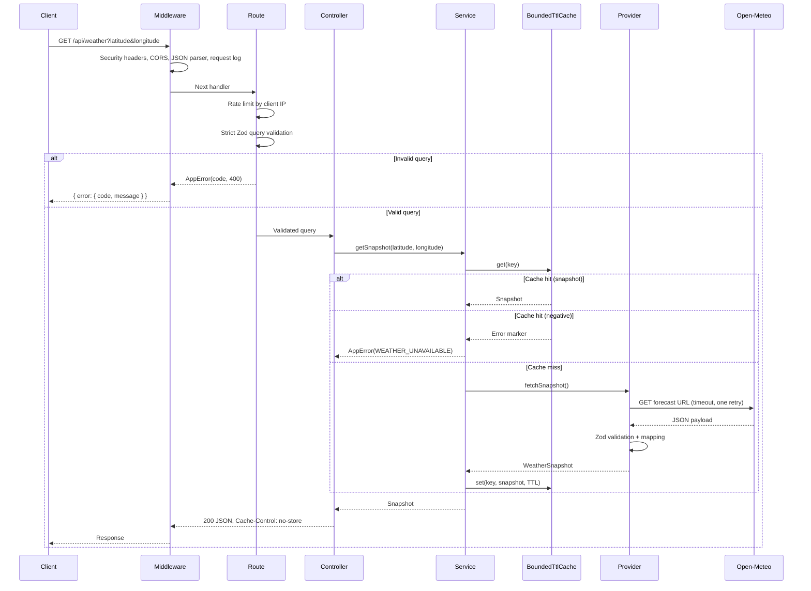

# Walday Backend

Express 5 + TypeScript JSON API that proxies weather and location data from Open-Meteo for the
Walday frontend.

## 1. Backend Overview

The backend is an independent, deployable part of Walday. Its responsibility is narrow and
read-only:

- Resolve free-text place names into location candidates.
- Retrieve current conditions and an hourly forecast for a coordinate pair.
- Validate every inbound request and every upstream payload.
- Protect the upstream provider with timeouts, bounded retries, TTL caching, negative caching,
  per-IP rate limiting, and an explicit CORS allowlist.
- Translate provider data into Walday's internal metric weather model and translate failures into
  stable, machine-readable error codes.

It is stateless and holds no user data. Tasks, commitments, preferences, and the last-known-good
weather snapshot live in the browser; the backend supplies only weather context. Weather is optional
to the product, so a backend failure must never block planning features on the frontend.

The frontend communicates with the backend over HTTP using `VITE_API_BASE_URL` as the base URL. The
browser never calls Open-Meteo directly. In the current implementation there is **no authentication,
no authorization, no database, and no persistence** — both endpoints are unauthenticated `GET`
routes.

See also [ADR 0008](../docs/adr/0008-weather-location-proxy.md) and
[ADR 0011](../docs/adr/0011-weather-backend-and-last-known-good.md) for the decisions behind this
design.

## 2. Technology Stack

| Responsibility          | Technology                                                                   |
| ----------------------- | ---------------------------------------------------------------------------- |
| Runtime                 | Node.js 24 (`>=24 <25`, pinned in [`.nvmrc`](../.nvmrc))                     |
| Language                | TypeScript 5, strict mode, ESM (`"type": "module"`)                          |
| Web framework           | Express 5                                                                    |
| Database and ORM        | None — no Prisma, no PostgreSQL, no migrations                               |
| Validation              | Zod 4 (router query, environment, upstream provider payloads)                |
| Authentication/security | No authentication; manual CORS allowlist, security headers, rate limiting    |
| HTTP client             | Native `fetch` with `AbortController`; no provider SDK or HTTP client        |
| Testing                 | Vitest 5, V8 coverage, route-level integration tests over a real HTTP server |
| Development tools       | ESLint 10, Prettier 3, npm 11+, Husky/lint-staged from the repository root   |
| Containerization        | None — no Dockerfile or Compose file exists                                  |

Application dependencies are deliberately small: only `express` and `zod`.

## 3. Architecture

The backend uses a layered request flow:

```text
routes → controllers → services → providers → lib
```

Configuration, domain models, and middleware wrap that flow.

### Routes

`src/routes/` defines the HTTP surface and middleware order. Each router:

- Mounts a `GET` path.
- Applies the endpoint-specific rate limiter.
- Parses `request.query` with a strict Zod schema and throws a domain error on failure.
- Delegates to a controller.

No provider call is made when validation fails.

### Controllers

`src/controllers/` maps validated input to a service call and writes the HTTP response. Controllers
do not contain business rules, caching, retry logic, or provider knowledge. They set
`Cache-Control: no-store` and return `200` with the JSON body.

### Services

`src/services/` holds framework-agnostic business rules:

- Cache lookup and cache population.
- Positive and negative TTL policy.
- Cache key construction.
- Error translation to stable `AppError` codes.

Services do not touch Express `Request` or `Response` objects.

### Providers

`src/providers/` contains the Open-Meteo clients:

- Build upstream URLs and query parameters.
- Validate provider JSON with Zod before use.
- Map provider payloads into the internal domain model.
- Enforce timeouts and a single bounded retry.

### Supporting layers

| Layer         | Location          | Responsibility                                                                       |
| ------------- | ----------------- | ------------------------------------------------------------------------------------ |
| Domain        | `src/domain/`     | Weather types, WMO condition mapping, plausible-value bounds, `AppError` codes       |
| Library       | `src/lib/`        | Bounded TTL cache, fetch-with-retry, clock and time helpers                          |
| Middleware    | `src/middleware/` | CORS, request logging, not-found handling, centralized error handling, rate limiting |
| Configuration | `src/config/`     | Zod-validated environment configuration and operational constants                    |
| Composition   | `src/app.ts`      | Wires configuration, providers, caches, services, routers, and middleware            |
| Entry point   | `src/server.ts`   | Loads configuration, starts the server, handles `SIGTERM`/`SIGINT`                   |

There is **no repository layer** because there is no persistence. The layers above are the complete
implementation; do not assume Prisma repositories exist.

### Request lifecycle



The same flow applies to `GET /api/weather/locations` with the geocoding provider.

## 4. Project Structure

```text
backend/
├── src/
│   ├── app.ts                  application assembly and dependency wiring
│   ├── server.ts               process entry point and graceful shutdown
│   ├── config/
│   │   └── env.ts              Zod environment schema, constants, config loader
│   ├── routes/                 endpoint paths, rate limits, query validation
│   ├── controllers/            HTTP request/response mapping
│   ├── services/               cache and business rules
│   ├── providers/              Open-Meteo clients and provider payload schemas
│   ├── middleware/             CORS, errors, not found, logging, rate limiting
│   ├── domain/                 weather model, condition mapping, error codes
│   └── lib/                    TTL cache, retry, time utilities
├── tests/                      Vitest suites and HTTP test helper
│   └── helpers/request.ts      boots the app on an ephemeral port with a fake fetch
├── .env.example                documented environment variables
├── eslint.config.js            ESLint flat configuration
├── vitest.config.ts            test discovery and coverage thresholds
├── tsconfig.json               strict type checking for source and tests
├── tsconfig.build.json         production compilation to dist/
└── package.json                scripts and dependencies
```

Important files:

- `src/app.ts` is the composition root. Tests use it directly with injected dependencies.
- `src/config/env.ts` is the authoritative list of supported environment variables and defaults.
- `src/domain/errors.ts` is the authoritative list of error codes, HTTP statuses, and messages.
- `src/domain/weather.ts` defines the internal API response model.
- `src/providers/schemas.ts` defines the upstream provider contracts.

## 5. Prerequisites

- **Node.js 24** (`>=24 <25`). The repository pins it in `.nvmrc`.
- **npm 11 or newer**.
- Network access to the Open-Meteo hostnames configured in the environment. No API key is required
  for development under the free tier.
- No database, message broker, container runtime, or external service is required.

```bash
nvm use            # or install Node.js 24 manually
node --version     # v24.x
npm --version      # 11.x or newer
```

## 6. Environment Configuration

The backend uses Node's native environment-file support. `npm run dev` loads `backend/.env` if it
exists (`--env-file-if-exists=.env`). The production `npm start` command does **not** load a file;
the process environment must provide the variables.

Copy the example and adjust only what is needed:

```bash
cp backend/.env.example backend/.env
```

The backend ships with working defaults, so a local run succeeds even without `.env`. Every value is
validated with Zod at startup; invalid values raise `ConfigValidationError` and the process exits
before listening. Values are never echoed in error messages.

| Variable                        | Default                                          | Purpose                                                                                 |
| ------------------------------- | ------------------------------------------------ | --------------------------------------------------------------------------------------- |
| `PORT`                          | `8787`                                           | HTTP port (integer, 1–65535).                                                           |
| `CORS_ALLOWED_ORIGINS`          | `http://localhost:5173`                          | Comma-separated exact origins allowed by CORS. At least one valid URL.                  |
| `TRUST_PROXY`                   | `false`                                          | Express `trust proxy` setting; enable behind a trusted proxy so client IPs are correct. |
| `OPEN_METEO_FORECAST_BASE_URL`  | `https://api.open-meteo.com/v1/forecast`         | Forecast provider endpoint.                                                             |
| `OPEN_METEO_GEOCODING_BASE_URL` | `https://geocoding-api.open-meteo.com/v1/search` | Geocoding provider endpoint.                                                            |
| `REQUEST_TIMEOUT_MS`            | `4000`                                           | Upstream request timeout in milliseconds (100–60000).                                   |
| `WEATHER_CACHE_TTL_MS`          | `600000`                                         | Successful weather cache lifetime (1000–86400000).                                      |
| `LOCATION_CACHE_TTL_MS`         | `600000`                                         | Successful location cache lifetime (1000–86400000).                                     |
| `NEGATIVE_CACHE_TTL_MS`         | `30000`                                          | Failure cache lifetime (100–3600000).                                                   |
| `RATE_LIMIT_WINDOW_MS`          | `60000`                                          | Fixed-window rate-limit duration (1000–3600000).                                        |
| `LOCATION_RATE_LIMIT`           | `30`                                             | Location requests allowed per IP per window.                                            |
| `WEATHER_RATE_LIMIT`            | `60`                                             | Weather requests allowed per IP per window.                                             |

See [`.env.example`](.env.example) for the documented template. `.env` is git-ignored and must not
be committed.

### Not configurable through environment

The following limits are code constants in `src/config/env.ts`:

- Request body limit: 16 KiB.
- Cache capacity: 1,000 entries per cache.
- Rate-limiter key capacity: 10,000 client keys.
- Forecast horizon: 2 days (canonical).
- Canonical units: metric (`temperature_unit=celsius`, `wind_speed_unit=kmh`,
  `precipitation_unit=mm`).

### Database connection

None. There is no database configuration, connection string, Prisma client, migration directory, or
seed script in this backend.

## 7. Getting Started

The root package is not an npm workspace; it delegates to `backend/` with `npm --prefix`. Both
approaches below are valid.

### 1. Install dependencies

From the repository root:

```bash
npm ci                # root tooling (Husky, lint-staged)
npm ci --prefix backend
```

Or from `backend/`:

```bash
npm ci
```

### 2. Configure environment variables

```bash
cp .env.example .env
```

Defaults work locally. Set `CORS_ALLOWED_ORIGINS` to the exact frontend origin (default
`http://localhost:5173`).

### 3. Start or connect to the database

Not applicable. The backend has no database.

### 4. Run database migrations

Not applicable. There is no migration tooling or schema.

### 5. Run seed scripts

Not applicable. There is no seed script.

### 6. Start the backend in development mode

From `backend/`:

```bash
npm run dev
```

This runs:

```text
node --watch --experimental-strip-types --env-file-if-exists=.env src/server.ts
```

Node strips TypeScript types natively and restarts on file changes. The API listens on
`http://localhost:8787` by default.

From the repository root, run the backend alone or both applications:

```bash
npm run dev:backend
npm run dev             # backend + frontend
```

### 7. Build and run the production version

```bash
npm run build           # tsc -p tsconfig.build.json → dist/
npm run start           # node dist/server.js
```

`npm start` requires a prior build and does not read `.env`; provide configuration through the
process environment. The build emits ESM JavaScript with source maps and rewrites `.ts` import
specifiers to `.js`.

From the repository root:

```bash
npm run build:backend
npm --prefix backend run start
```

### Smoke checks

With the server running:

```bash
curl "http://localhost:8787/api/weather?latitude=40.4165&longitude=-3.7026"
curl "http://localhost:8787/api/weather/locations?query=Madrid&language=en&limit=5"
curl -i "http://localhost:8787/api/weather?latitude=999&longitude=0"
```

For a complete validation guide, see the
[weather integration quickstart](../specs/007-weather-integration/quickstart.md).

## 8. Database

There is no database in the current backend.

- **Database technology:** none.
- **Prisma integration:** none. There is no `schema.prisma`, generated client, or Prisma dependency.
- **Schema location:** not applicable.
- **Migration workflow:** not applicable.
- **Seed data workflow:** not applicable.
- **Database development commands:** none.

All runtime state is process-local: an in-memory bounded TTL cache for successful responses and
failure markers, plus an in-memory fixed-window rate limiter. Restarting the process clears both.
The project constitution names PostgreSQL and Prisma as the intended persistence stack for future
features, but that target is not implemented here. Do not document or assume repositories,
migrations, or seed commands until they exist.

## 9. API Organization

All routes are mounted under `/api`. Both endpoints are unauthenticated, read-only, and return JSON.

| Method | Path                     | Purpose                                                       |
| ------ | ------------------------ | ------------------------------------------------------------- |
| `GET`  | `/api/weather`           | Current conditions and hourly forecast for a coordinate pair. |
| `GET`  | `/api/weather/locations` | Location search candidates for a free-text query.             |

### `GET /api/weather`

Query parameters (strict; unknown parameters are rejected):

| Parameter   | Required | Rules                       |
| ----------- | -------- | --------------------------- |
| `latitude`  | Yes      | Finite number, −90 to 90.   |
| `longitude` | Yes      | Finite number, −180 to 180. |

Successful response (`200`, `Cache-Control: no-store`):

```json
{
  "units": "metric",
  "retrievedAt": "2026-11-16T05:18:07.120Z",
  "observedAt": "2026-11-16T05:00:00.000Z",
  "current": {
    "temperatureCelsius": 12.4,
    "apparentTemperatureCelsius": 11.8,
    "relativeHumidityPercent": 74,
    "windSpeedKilometersPerHour": 9.3,
    "precipitationMillimeters": 0,
    "condition": "partly-cloudy"
  },
  "hourly": [
    {
      "time": 1763269200,
      "temperatureCelsius": 12.4,
      "condition": "partly-cloudy",
      "precipitationProbability": 5
    }
  ]
}
```

Behavioral notes from the implementation:

- Values are always metric; display-unit conversion is a frontend concern.
- `current` may be `null`; individual measurements may be `null`. `condition` is always present and
  is one of `clear`, `partly-cloudy`, `cloudy`, `rain`, `snow`, `storm`, `fog`, `unknown`.
- `observedAt` is `null` when the provider time is absent, non-finite, or more than 5 minutes in the
  future.
- `hourly` is chronological, de-duplicated by `time`, may be empty, and is capped at 48 entries.
- Invalid or implausible individual values map to `null`, never `0`.
- A provider `400` for valid coordinates is treated as no coverage: `200` with `current: null` and
  an empty `hourly` array.
- A cache hit preserves the original `retrievedAt`.

### `GET /api/weather/locations`

Query parameters (strict; unknown parameters are rejected):

| Parameter  | Required | Rules                                                 |
| ---------- | -------- | ----------------------------------------------------- |
| `query`    | Yes      | Trimmed, 1–80 graphemes, control characters rejected. |
| `language` | No       | `en` or `es`; defaults to `en`.                       |
| `limit`    | No       | Integer 1–10; defaults to `5`.                        |

The query is trimmed, collapsed, and lowercased before being sent upstream. Successful response
(`200`, `Cache-Control: no-store`):

```json
{
  "results": [
    {
      "providerPlaceId": "3117735",
      "name": "Madrid",
      "region": "Community of Madrid",
      "countryCode": "ES",
      "latitude": 40.4165,
      "longitude": -3.7026
    }
  ]
}
```

`results` is de-duplicated by `providerPlaceId`, may be empty, and is never `null`.

### Conventions

- API field names and condition literals are an internal contract shared with the frontend; changing
  them is a breaking change.
- Provider DTOs, provider hostnames, upstream error bodies, stack traces, and coordinates never
  appear in responses or logs.
- The authoritative contract is
  [specs/007-weather-integration/contracts/weather-api.md](../specs/007-weather-integration/contracts/weather-api.md).
- There is no API versioning, authentication, pagination, or write endpoint in the current
  implementation.

## 10. Validation and Error Handling

### Request validation

Each route validates `request.query` with a strict Zod schema (`weatherQuerySchema`,
`locationQuerySchema`). `.strict()` rejects unknown parameters, and `z.coerce.number()` handles query
string coercion. The rate limiter runs first, then validation; no provider call is made for an
invalid request.

### Environment validation

`src/config/env.ts` validates the whole configuration with Zod at startup. Numbers are coerced and
bounded, URLs are validated, booleans accept only `'true'`/`'false'`, and CORS origins are split on
commas and validated as URLs. Failure produces a `ConfigValidationError` listing the offending
variable names without their values.

### Upstream validation

Provider payloads are parsed with Zod in `src/providers/schemas.ts`. Forecast measurements are
accepted as unknown values and then bounded per field; malformed payloads fail as
`WEATHER_UNAVAILABLE`. Geocoding results are validated per item; invalid items are skipped, and
duplicate place IDs are removed.

### Centralized error handling

Route handlers throw, and the final error middleware (`src/middleware/errorHandler.ts`) serializes
the response. Express 5 forwards rejected async handlers automatically. Unknown routes pass through
`notFound` and produce `NOT_FOUND`.

`AppError` couples a stable code to an HTTP status and a fixed English message
(`src/domain/errors.ts`). Unexpected errors become `INTERNAL_ERROR` with no internal detail.
Payloads exceeding the body limit produce `413` with `INTERNAL_ERROR`.

### Error response envelope

```json
{
  "error": {
    "code": "WEATHER_UNAVAILABLE",
    "message": "Weather is temporarily unavailable."
  }
}
```

`details` is included only when an error supplies non-null details.

| HTTP | Code                           | When                                                                                    |
| ---- | ------------------------------ | --------------------------------------------------------------------------------------- |
| 400  | `WEATHER_LOCATION_INVALID`     | Missing, malformed, or out-of-range coordinates.                                        |
| 400  | `LOCATION_QUERY_INVALID`       | Missing, empty, too long, control characters, bad language/limit, or unknown parameter. |
| 404  | `NOT_FOUND`                    | Unknown route.                                                                          |
| 413  | `INTERNAL_ERROR`               | Request body exceeds 16 KiB.                                                            |
| 429  | `WEATHER_RATE_LIMITED`         | Weather per-IP window exceeded (60/min by default).                                     |
| 429  | `LOCATION_RATE_LIMITED`        | Location per-IP window exceeded (30/min by default).                                    |
| 500  | `INTERNAL_ERROR`               | Unexpected failure.                                                                     |
| 503  | `WEATHER_UNAVAILABLE`          | Provider timeout, network failure, 5xx, malformed payload, or negative cache.           |
| 503  | `LOCATION_SERVICE_UNAVAILABLE` | Same conditions for geocoding.                                                          |

### Security behavior

- `x-powered-by` is disabled.
- Every response sets `X-Content-Type-Options: nosniff` and `Referrer-Policy: no-referrer`.
- CORS echoes `Access-Control-Allow-Origin` only for configured origins, always sends `Vary: Origin`,
  allows only `GET, OPTIONS` and `Accept, Content-Type` headers, and never emits a wildcard.
  Preflight requests return `204`.
- Rate limiting is a fixed window keyed by client IP (`request.ip`, influenced by `TRUST_PROXY`),
  bounded to 10,000 keys with pruning.
- Request logs are JSON lines containing method, path, status, and duration; query strings are
  excluded, so coordinates and search text are not logged.
- Responses are marked `Cache-Control: no-store`; caching is internal only.

### Outbound provider calls

- `GET` only, `Accept: application/json`, `cache: 'no-store'`.
- Timeout via `AbortController` (`REQUEST_TIMEOUT_MS`).
- At most one retry (two total attempts) for timeout, network error, `429`, or `5xx`.
- Backoff of 250 ms plus up to 250 ms of jitter.
- Other `4xx` responses are not retried.

## 11. Testing

- **Framework:** Vitest 5 with the Node environment and globals enabled.
- **Discovery:** `tests/**/*.test.ts` (configured in `vitest.config.ts`).
- **Coverage:** V8 provider; `text`, `html`, and `lcov` reporters; source included from
  `src/**/*.ts`, excluding `src/server.ts` and type declaration files.
- **Thresholds:** 80% statements, 75% branches, 80% functions, 80% lines.

Run tests:

```bash
npm run test
npm run test:coverage
```

From the repository root: `npm run test:backend` or `npm run test:coverage`.

### Test organization

| File                                 | Area                                                   |
| ------------------------------------ | ------------------------------------------------------ |
| `tests/weather-route.test.ts`        | `GET /api/weather` contract, caching, retries, CORS.   |
| `tests/weather-hourly-route.test.ts` | Hourly series ordering, de-duplication, and bounds.    |
| `tests/weather-errors.test.ts`       | Provider failure and error-mapping behavior.           |
| `tests/location-route.test.ts`       | `GET /api/weather/locations` contract and validation.  |
| `tests/security.test.ts`             | Headers, CORS, log hygiene, and the 16 KiB body limit. |
| `tests/rate-limit.test.ts`           | Fixed-window limiter behavior and key bounding.        |
| `tests/cache.test.ts`                | TTL expiry, replacement, and capacity pruning.         |
| `tests/retry.test.ts`                | Timeout, retry eligibility, and backoff injection.     |
| `tests/provider-schema.test.ts`      | Upstream Zod schemas and payload mapping.              |
| `tests/condition-mapping.test.ts`    | WMO code mapping and plausible-value bounds.           |
| `tests/config.test.ts`               | Defaults, parsing, and fail-fast validation.           |

`tests/helpers/request.ts` boots the real Express app on an ephemeral port with an injected fake
`fetch`, so route tests exercise middleware, validation, and response serialization without network
access. Dependencies (clock, logger, sleep, random) are injectable through `createApp` for
deterministic tests.

Backend policy requires tests for services, validation, route behavior, and centralized error
handling. Add a route-level test when changing an endpoint contract, and a provider/schema test when
changing upstream mapping.

## 12. Development Commands

Run these from `backend/`. The root equivalents delegate to the same scripts.

| Command                 | Purpose                                                       |
| ----------------------- | ------------------------------------------------------------- |
| `npm run dev`           | Start with `node --watch`, native type stripping, and `.env`. |
| `npm run build`         | Compile TypeScript to `dist/`.                                |
| `npm run start`         | Run the compiled server (`node dist/server.js`); build first. |
| `npm run lint`          | Run ESLint over the backend.                                  |
| `npm run format:check`  | Verify Prettier formatting (no write).                        |
| `npm run typecheck`     | Type-check source, tests, and Vitest config with `tsc`.       |
| `npm run test`          | Run the Vitest suite once.                                    |
| `npm run test:coverage` | Run Vitest with V8 coverage and thresholds.                   |

Root delegation:

| Root command                | Delegates to          |
| --------------------------- | --------------------- |
| `npm run dev:backend`       | `backend` `dev`       |
| `npm run build:backend`     | `backend` `build`     |
| `npm run lint:backend`      | `backend` `lint`      |
| `npm run typecheck:backend` | `backend` `typecheck` |
| `npm run test:backend`      | `backend` `test`      |

There is no `format` write script and no database command. Use `npm exec -- prettier --write .` only
if you intentionally want to reformat; CI and hooks use `format:check`.

### Quality gates

- Pre-commit: lint-staged runs Prettier (and ESLint for `.ts`) on staged backend files, plus
  `format:check`.
- Pre-push: `typecheck`, `test:coverage`, and `build` at the repository root.
- CI (`.github/workflows/ci.yml`): `lint`, `format:check`, `typecheck`, `test`, `test:coverage`, then
  `build` on Node 24.

## 13. Related Documentation

- [Root README](../README.md) — full repository overview, architecture, and commands.
- [Project Constitution](../.specify/memory/constitution.md) — engineering principles, backend layer
  rules, TypeScript standards, and quality gates.
- [Product Overview](../docs/product-overview.md) — product vision, MVP scope, and weather
  requirements.
- [Frontend README](../frontend/README.md) — SPA architecture and its backend boundary.
- [Weather API Contract](../specs/007-weather-integration/contracts/weather-api.md) — authoritative
  endpoint contract and field rules.
- [Weather Integration Quickstart](../specs/007-weather-integration/quickstart.md) — configuration,
  smoke checks, and end-to-end validation scenarios.
- [ADR 0008: Weather Location Resolution Through a Backend Proxy](../docs/adr/0008-weather-location-proxy.md)
- [ADR 0011: Weather Backend Proxy and Last-Known-Good Snapshot](../docs/adr/0011-weather-backend-and-last-known-good.md)
- [AGENTS.md](../AGENTS.md) — repository instructions for contributors and coding agents.
